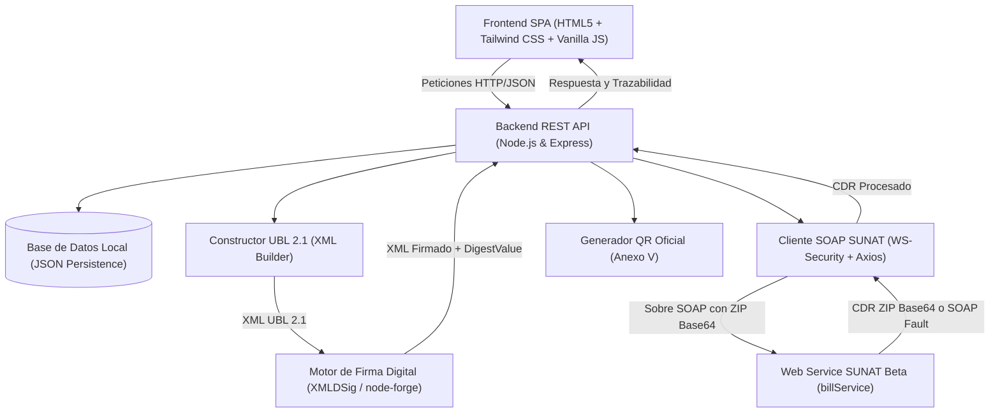
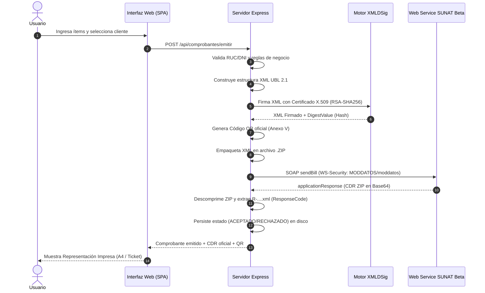

# INFORME TÉCNICO
## Desarrollo de Aplicación Cliente de Facturación Electrónica con Integración SUNAT (UBL 2.1)

---

### 1. Resumen Ejecutivo
El presente trabajo práctico implementa un sistema cliente integral de facturación electrónica conforme a las exigencias técnicas y tributarias establecidas por la **Superintendencia Nacional de Aduanas y de Administración Tributaria (SUNAT)** de la República del Perú.

La solución abarca desde la administración de catálogos y datos maestros (Emisor, Clientes, Catálogo de Productos/Servicios con afectación al IGV), la generación de comprobantes bajo el estándar internacional **UBL 2.1 (Universal Business Language - ISO/IEC 19845:2015)**, la firma digital mediante certificados digitales **X.509 PKCS#12 (XMLDSig)**, la transmisión a través del protocolo **SOAP** con autenticación **WS-Security (SOL)** hacia el entorno de pruebas (Beta/Homologación), hasta el procesamiento de la **Constancia de Recepción (CDR)** y la generación de la **Representación Impresa (PDF / Ticket 80mm)** con el **Código QR oficial (Anexo V)** y el código Hash del comprobante (`DigestValue`).

---

### 2. Arquitectura de la Solución

La aplicación está diseñada bajo una arquitectura modular desacoplada:



#### Diagrama de Secuencia: Flujo de Emisión y Transmisión



---

### 3. Estructuración XML según UBL 2.1

La aplicación genera comprobantes bajo el estándar UBL 2.1 normado por la Resolución de Superintendencia N° 097-2012/SUNAT y sus modificatorias:

- **Factura Electrónica**: Tipo de documento `01`, elemento raíz `<Invoice>`, serie con formato `F###` (ej. `F001`).
- **Boleta de Venta Electrónica**: Tipo de documento `03`, elemento raíz `<Invoice>`, serie con formato `B###` (ej. `B001`).

#### Espacios de Nombres (Namespaces) Requeridos:
- `xmlns="urn:oasis:names:specification:ubl:schema:xsd:Invoice-2"`
- `xmlns:cac="urn:oasis:names:specification:ubl:schema:xsd:CommonAggregateComponents-2"`
- `xmlns:cbc="urn:oasis:names:specification:ubl:schema:xsd:CommonBasicComponents-2"`
- `xmlns:ds="http://www.w3.org/2000/09/xmldsig#"`
- `xmlns:ext="urn:oasis:names:specification:ubl:schema:xsd:CommonExtensionComponents-2"`

#### Nodos Clave Implementados:
1. `<ext:UBLExtensions>`: Contenedor donde se inserta el bloque de firma digital `<ds:Signature>`.
2. `<cbc:UBLVersionID>2.1</cbc:UBLVersionID>`: Declara la versión del estándar UBL.
3. `<cbc:CustomizationID>2.0</cbc:CustomizationID>`: Declara la versión del esquema de fiscalización de SUNAT.
4. `<cac:AccountingSupplierParty>`: Datos fiscales del emisor (RUC, Razón Social, Dirección, Ubigeo INEI).
5. `<cac:AccountingCustomerParty>`: Datos fiscales del cliente receptor.
6. `<cac:TaxTotal>`: Desglose de impuestos por categorías (Tributo 1000 - IGV 18%, Tributo 9997 - Exonerado, Tributo 9998 - Inafecto).
7. `<cac:LegalMonetaryTotal>`: Totales monetarios (Valor de Venta, Impuestos e Importe Total a Pagar).
8. `<cac:InvoiceLine>`: Detalle de cada ítem con cantidad, unidad de medida (Catálogo 03), precio unitario, código de afectación (Catálogo 07) y valor de venta.

---

### 4. Proceso de Firma Digital (XMLDSig)

El documento XML generado debe ser firmado digitalmente antes de su transmisión:

- **Formato del Certificado**: Certificado digital X.509 en formato PKCS#12 (`.pfx` o `.p12`). La aplicación incluye un módulo para importar certificados oficiales o generar certificados de prueba autofirmados de 2048 bits con algoritmo RSA.
- **Algoritmo de Firma**: `http://www.w3.org/2001/04/xmldsig-more#rsa-sha256` (RSA con SHA-256).
- **Algoritmo de Resumen (Digest)**: `http://www.w3.org/2001/04/xmlenc#sha256` (SHA-256).
- **Canonicalización**: `http://www.w3.org/2001/10/xml-exc-c14n#` (Exclusive Canonicalization).
- **Transformación**: `http://www.w3.org/2000/09/xmldsig#enveloped-signature`.
- **Extracción del DigestValue**: Durante la firma se extrae el valor hash (`<ds:DigestValue>`), el cual representa la huella digital criptográfica del documento y es obligatorio tanto en la representación impresa como en el código QR.

---

### 5. Integración con el Web Service de SUNAT (SOAP)

#### Endpoints Oficiales (Entorno Beta / Homologación):
- **URL del Servicio**: `https://e-beta.sunat.gob.pe/ol-ti-itcpfegem-beta/billService`
- **Operación**: `sendBill`
- **Parámetros**:
  - `fileName`: Nombre del archivo comprimido `{RUC}-{TIPO}-{SERIE}-{NUMERO}.zip` (ej. `20000000001-01-F001-00000001.zip`).
  - `contentFile`: Contenido del archivo ZIP codificado en Base64.

#### Autenticación WS-Security:
El sobre SOAP transporta las credenciales en la cabecera mediante `wsse:UsernameToken`:
- `wsse:Username`: Concatenación del RUC y el Usuario SOL (ej. `20000000001MODDATOS`).
- `wsse:Password`: Clave SOL (ej. `moddatos`).

#### Procesamiento de la Respuesta (CDR):
1. **Éxito**: SUNAT responde con un elemento `<applicationResponse>` en Base64, el cual corresponde a un archivo ZIP que contiene la **Constancia de Recepción (CDR)** denominada `R-{RUC}-{TIPO}-{SERIE}-{NUMERO}.xml`.
2. **Evaluación de Código**:
   - `ResponseCode = 0`: Comprobante **Aceptado** satisfactoriamente.
   - `ResponseCode != 0`: Comprobante **Rechazado** u observado con código y descripción de la falta.
3. **Excepciones / SOAP Faults**: Si las credenciales son incorrectas o el formato de archivo es inválido, el servidor devuelve un `<faultcode>` y `<faultstring>`, los cuales son capturados y clasificados por el sistema.
4. **Modo Simulación Local**: La aplicación cuenta con un conmutador de simulación que permite ejecutar todo el ciclo (validación, firma, cálculo de hash y emisión de CDR válido) de forma local, asegurando continuidad aún en contingencias de red.

---

### 6. Representación Impresa y Código QR

La normativa de la SUNAT exige que la representación física (impresión o PDF) contenga:
1. Datos completos del emisor y receptor.
2. Desglose detallado de operaciones gravadas, exoneradas, inafectas e IGV (18%).
3. Importe total expresado en letras (según Catálogo 52).
4. El resumen del comprobante (Código Hash / `DigestValue`).
5. **Código QR oficial según el Anexo V**:
   Cadena de texto con delimitadores pipe (`|`):
   ```text
   RUC|TipoDoc|Serie|Numero|MontoIGV|MontoTotal|FechaEmision|TipoDocCliente|NumDocCliente|DigestValue|
   ```
   *Ejemplo real generado por la aplicación:*
   `20000000001|01|F001|00000001|180.00|1420.00|2026-11-06|6|20100070970|xmGJ6mYZSD1v8hXkWONgvc3FUSToIjMn9YRU9bG9HyY=|`

6. **Formatos Soportados**:
   - **Formato A4**: Documento formal corporativo.
   - **Formato Ticket (80mm)**: Formato térmico compacto para puntos de venta minorista.

---

### 7. Manejo de Errores y Validaciones Preventivas

El sistema implementa validaciones en múltiples capas antes de intentar la transmisión:
1. **Validación de RUC**: Implementación matemática del algoritmo **Módulo 11** de SUNAT con factores `[5, 4, 3, 2, 7, 6, 5, 4, 3, 2]` y verificación de prefijos válidos (`10`, `15`, `17`, `20`).
2. **Validación de DNI**: Verificación de longitud exacta de 8 dígitos numéricos.
3. **Reglas Tributarias**:
   - Las Facturas (01) exigen estrictamente clientes con RUC (Tipo 6).
   - Las Boletas (03) con monto mayor o igual a S/ 700.00 exigen obligatoriamente la identificación del cliente.
   - Las series deben concordar con el tipo (`F` para facturas, `B` para boletas).

---

### 8. Conclusiones
La solución desarrollada satisface con rigurosidad técnica y tributaria todos los requerimientos estipulados para el Trabajo Práctico:
- Genera archivos XML con sintaxis 100% conforme a UBL 2.1.
- Ejecuta la firma digital XMLDSig con extracción de huella criptográfica.
- Implementa la conexión SOAP a SUNAT Beta con autenticación WS-Security y procesamiento de CDR.
- Ofrece una interfaz de usuario moderna, intuitiva y con doble formato de representación impresa.
